# Lab Dependency Graph

This document shows the prerequisite relationships between labs in the AI for the Win curriculum.

## Current Threat Landscape (2025-2026)

This curriculum addresses the most critical AI/ML security threats identified by OWASP, NIST, and industry research, plus the ransomware, C2 and nation-state activity the DFIR and threat intelligence labs teach. Last verified November 2026; details and dated sources are in the [Threat Landscape 2025-2026 reference](guides/threat-landscape-2025.md).

| Threat | Labs Covering | Priority |
|--------|---------------|----------|
| **Prompt Injection** (OWASP LLM01:2026, ATLAS AML.T0051) | Labs 40, 49 | Critical |
| **Agentic AI Exploits** (OWASP LLM03:2026 Excessive Agency; Agentic ASI01 Goal Hijack, ASI02 Tool Misuse) | Labs 14, 16, 49 | Critical |
| **RAG Poisoning** (OWASP LLM09:2026 Vector and Embedding Weaknesses, ATLAS AML.T0070) | Labs 18, 43 | Critical |
| **Data/Model Poisoning** (OWASP LLM05:2026) | Labs 39, 41 | High |
| **AI-Powered Threat Actors** (LLM-querying malware, agentic offensive frameworks) | Lab 37 | High |
| **Ransomware** (Qilin, The Gentlemen, DragonForce; data-theft extortion, ESXi targeting) | Labs 30, 31, 32 | High |
| **C2 Frameworks** (Sliver, Havoc, AdaptixC2, Metasploit; agentic C2 such as ARTEX) | Lab 34 | High |
| **Nation-State APTs** (China, Russia, Iran, North Korea) | Labs 36, 37 | High |
| **Adversarial ML Attacks** (ATLAS AML.T0043) | Labs 38, 39 | High |
| **Supply Chain Attacks** (OWASP LLM04:2026; Agentic ASI04) | Labs 40, 46 | Medium |
| **Model Extraction/Theft** (ATLAS AML.T0024; no longer a separate OWASP entry) | Labs 39, 41 | Medium |

Sources: [OWASP GenAI LLM Top 10 2026](https://genai.owasp.org/resource/owasp-genai-llm-top-10-2026/) (2026-08-03), [OWASP Top 10 for Agentic Applications](https://genai.owasp.org/2025/12/09/owasp-top-10-for-agentic-applications-the-benchmark-for-agent) (2025-12-09), [MITRE ATLAS](https://atlas.mitre.org/), [Check Point State of Ransomware Q3 2026](https://research.checkpoint.com/2026/the-state-of-ransomware-q3-2026/) (2026-11-18), [Kaspersky Securelist Q2 2026](https://securelist.com/vulnerabilities-and-exploits-in-q2-2026/121091/) (2026-08-26), [GTIG AI Threat Tracker](https://cloud.google.com/blog/topics/threat-intelligence/agentic-threat-activity-crosses-a-significant-threshold) (2026-11-16).

## Visual Overview

```mermaid
flowchart TD
    subgraph Foundations["Foundations (Labs 00-09)"]
        L00[Lab 00: Environment Setup]
        L01[Lab 01: Python Basics]
        L02[Lab 02: Prompt Engineering]
        L03[Lab 03: Vibe Coding]
        L04[Lab 04: ML Concepts]
        L05[Lab 05: AI in Security Ops]
        L06[Lab 06: Visualization]
        L07[Lab 07: Hello World ML]
        L08[Lab 08: Working with APIs]
        L09[Lab 09: CTF Fundamentals]
    end

    subgraph MLTrack["ML Track (Labs 10-13)"]
        L10[Lab 10: Phishing Classifier]
        L11[Lab 11: Malware Clustering]
        L12[Lab 12: Anomaly Detection]
        L13[Lab 13: ML vs LLM Bridge]
    end

    subgraph LLMTrack["LLM Track (Labs 14-18)"]
        L14[Lab 14: First AI Agent]
        L15[Lab 15: LLM Log Analysis]
        L16[Lab 16: Threat Intel Agent]
        L17[Lab 17: Embeddings & Vectors]
        L18[Lab 18: Security RAG]
    end

    subgraph Detection["Detection Engineering (Labs 19-24)"]
        L19[Lab 19: Binary Basics]
        L20[Lab 20: Sigma Fundamentals]
        L21[Lab 21: YARA Generator]
        L22[Lab 22: Vuln Scanner AI]
        L23[Lab 23: Detection Pipeline]
        L24[Lab 24: Monitoring AI]
    end

    subgraph DFIR["DFIR Track (Labs 25-35)"]
        L25[Lab 25: DFIR Fundamentals]
        L29[Lab 29: IR Copilot]
        L30[Lab 30: Ransomware Fundamentals]
        L31[Lab 31: Ransomware Detection]
        L32[Lab 32: Ransomware Simulation]
        L33[Lab 33: Memory Forensics]
        L34[Lab 34: C2 Traffic]
        L35[Lab 35: Lateral Movement]
    end

    subgraph ThreatIntel["Threat Intelligence (Labs 36-37)"]
        L36[Lab 36: Threat Actor Profiling]
        L37[Lab 37: AI-Powered Threats]
    end

    subgraph AISecurity["AI Security (Labs 38-43)"]
        L38[Lab 38: ML Security Intro]
        L39[Lab 39: Adversarial ML]
        L40[Lab 40: LLM Security Testing]
        L41[Lab 41: Model Monitoring]
        L42[Lab 42: Fine Tuning Security]
        L43[Lab 43: RAG Security]
    end

    subgraph Cloud["Cloud Security (Labs 44-48)"]
        L44[Lab 44: Cloud Fundamentals]
        L45[Lab 45: Cloud Security AI]
        L46[Lab 46: Container Security]
        L47[Lab 47: Serverless Security]
        L48[Lab 48: Cloud IR Automation]
    end

    subgraph Advanced["Advanced (Labs 49-50)"]
        L49[Lab 49: LLM Red Teaming]
        L50[Lab 50: Purple Team AI]
    end

    %% Foundation dependencies
    L00 --> L01
    L01 --> L02
    L01 --> L04
    L01 --> L06
    L01 --> L07
    L01 --> L08
    L04 --> L07

    %% ML Track
    L07 --> L10
    L10 --> L11
    L11 --> L12
    L12 --> L13

    %% LLM Track
    L08 --> L14
    L08 --> L15
    L14 --> L16
    L15 --> L16
    L15 --> L17
    L17 --> L18

    %% Detection Track (updated - no circular deps)
    L01 --> L19
    L01 --> L20
    L08 --> L20
    L20 --> L21
    L21 --> L22
    L22 --> L23
    L15 --> L24
    L23 --> L24

    %% DFIR Track
    L01 --> L25
    L25 --> L29
    L25 --> L30
    L30 --> L31
    L31 --> L32
    L32 --> L33
    L33 --> L34
    L34 --> L35

    %% Threat Intel Track
    L35 --> L36
    L36 --> L37

    %% AI Security Track (updated with correct deps)
    L07 --> L38
    L10 --> L39
    L13 --> L39
    L23 --> L39
    L38 --> L39
    L38 --> L40
    L38 --> L41
    L40 --> L41
    L18 --> L42
    L18 --> L43
    L38 --> L43
    L40 --> L43

    %% Cloud Track (updated)
    L08 --> L44
    L44 --> L45
    L44 --> L46
    L45 --> L46
    L44 --> L47
    L46 --> L47
    L25 --> L48
    L44 --> L48
    L46 --> L48
    L47 --> L48

    %% Advanced Track (updated)
    L02 --> L49
    L14 --> L49
    L40 --> L49
    L49 --> L50
```



## Learning Paths

### Beginner Path (Start Here!)

```
Lab 00 → Lab 01 → Lab 02 → Lab 07 → Lab 10
```

### ML-Focused Path

```
Lab 01 → Lab 04 → Lab 07 → Lab 10 → Lab 11 → Lab 12 → Lab 13
```

### LLM-Focused Path

```
Lab 01 → Lab 08 → Lab 14 → Lab 15 → Lab 16 → Lab 17 → Lab 18
```

### Detection Engineering Path

```
Lab 01 → Lab 08 → Lab 20 → Lab 21 → Lab 22 → Lab 23 → Lab 24
```

### DFIR Path

```
Lab 01 → Lab 25 → Lab 30 → Lab 31 → Lab 32 → Lab 33 → Lab 34 → Lab 35
```

### AI Security Path (Critical for 2025-2026 Threats)

```
Lab 07 → Lab 38 → Lab 39 → Lab 40 → Lab 41 → Lab 49 → Lab 50
              ↓
         Lab 18 → Lab 43 (RAG Security)
```

### Cloud Security Path

```
Lab 08 → Lab 44 → Lab 45 → Lab 46 → Lab 47 → Lab 48
                     ↑
                Lab 25 (DFIR Fundamentals for Cloud IR)
```

## Prerequisites Quick Reference

| Lab | Prerequisites | Topic |
|-----|---------------|-------|
| 00 | None | Environment Setup |
| 01 | Lab 00 | Python Basics |
| 02-09 | Lab 01 | Foundations |
| 10 | Lab 07 | Phishing Classifier |
| 11-12 | Previous lab | ML Security |
| 13 | Lab 12 | ML vs LLM Bridge |
| 14 | Lab 08 | First AI Agent |
| 15 | Lab 08 | LLM Log Analysis |
| 16 | Labs 14, 15 | Threat Intel Agent |
| 17 | Lab 15 | Embeddings & Vectors |
| 18 | Lab 17 | Security RAG |
| 19 | Lab 01 | Binary Basics |
| 20 | Labs 01, 08 | Sigma Fundamentals |
| 21-23 | Previous lab | Detection Engineering |
| 24 | Labs 15, 23 | Monitoring AI |
| 25 | Lab 01 | DFIR Fundamentals |
| 26-29 | Lab 25 | DFIR Deep Dives |
| 30 | Lab 25 | Ransomware Fundamentals |
| 31-35 | Previous lab | Ransomware/Threats |
| 36-37 | Previous lab | Threat Intelligence |
| 38 | Lab 07 | ML Security Intro |
| 39 | Labs 10-13, 23, 38 | Adversarial ML |
| 40 | Lab 38 | LLM Security Testing |
| 41 | Labs 38, 40 | Model Monitoring |
| 42 | Lab 18 | Fine-Tuning Security |
| 43 | Labs 18, 38, 40 | RAG Security |
| 44 | Lab 08 | Cloud Fundamentals |
| 45 | Lab 44 | Cloud Security AI |
| 46 | Labs 44, 45 | Container Security |
| 47 | Labs 44, 46 | Serverless Security |
| 48 | Labs 25, 44, 46, 47 | Cloud IR Automation |
| 49 | Labs 02, 14-18, 40 | LLM Red Teaming |
| 50 | Lab 49 | Purple Team AI |

## Skill Progression Logic

The curriculum follows a logical skill progression:

1. **Foundations First**: Python, APIs, and basic ML concepts enable all subsequent labs
2. **Build Before Break**: Learn to build ML/LLM systems (Labs 10-18) before attacking them (Labs 38-43)
3. **Detect Before Respond**: Detection engineering (Labs 19-24) before incident response (Labs 25-35)
4. **Defense Informs Offense**: Understanding defenses (Labs 38-43) before red teaming (Labs 49-50)
5. **Cross-Domain Integration**: Cloud IR (Lab 48) requires both DFIR (Lab 25) and Cloud (Labs 44-47)
