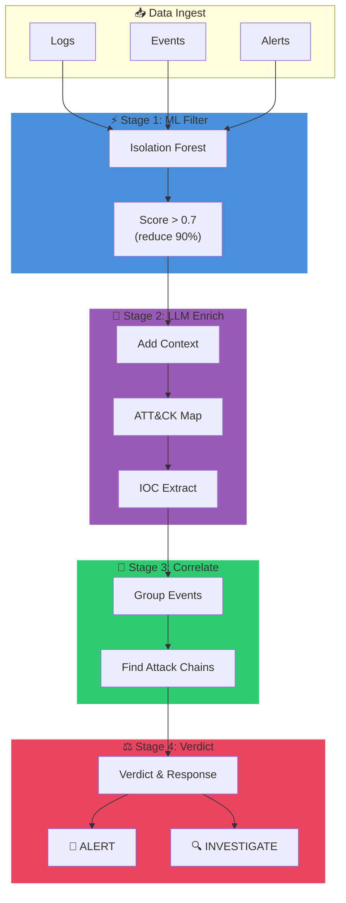

# Lab 23: Multi-Stage Threat Detection Pipeline

**Difficulty:** 🟠 Advanced | **Time:** 90-120 min | **Prerequisites:** Labs 13, 15-18

Build an end-to-end threat detection pipeline combining ML and LLM components.

---

## 🎯 Learning Objectives

By completing this lab, you will:

1. Design multi-stage detection architectures
2. Combine ML models with LLM reasoning
3. Implement alert correlation and enrichment
4. Build confidence scoring systems
5. Create detection-to-response workflows

---

## ⏱️ Estimated Time

120-150 minutes (with AI assistance)

---

## 📋 Prerequisites

- Completed Labs 10-22
- Strong Python skills
- Understanding of detection engineering

### Required Libraries

```bash
pip install langchain langchain-anthropic scikit-learn
pip install pandas numpy redis  # For caching/queuing
pip install fastapi uvicorn     # For API
pip install rich
```

---

## 📖 Background

### Pipeline Architecture



**ASCII fallback (for non-Mermaid viewers):**

```
┌────────────────────────────────────────────────────────────────────┐
│                    THREAT DETECTION PIPELINE                        │
├────────────────────────────────────────────────────────────────────┤
│                                                                     │
│  ┌─────────┐   ┌─────────────┐   ┌────────────┐   ┌─────────────┐ │
│  │  Data   │──►│  Stage 1:   │──►│  Stage 2:  │──►│  Stage 3:   │ │
│  │ Ingest  │   │  ML Filter  │   │  LLM Enrich│   │  Correlate  │ │
│  └─────────┘   └─────────────┘   └────────────┘   └─────────────┘ │
│       │              │                 │                 │         │
│       ▼              ▼                 ▼                 ▼         │
│    Logs         Score >0.7        Add Context       Group Events  │
│    Events       (reduce 90%)      ATT&CK Map        Find Chains   │
│    Alerts                         IOC Extract                      │
│                                                                     │
│                          ┌─────────────┐                           │
│                          │  Stage 4:   │                           │
│                          │  Verdict &  │──► ALERT / INVESTIGATE   │
│                          │  Response   │                           │
│                          └─────────────┘                           │
└────────────────────────────────────────────────────────────────────┘
```

### Stage Responsibilities

| Stage | Technology | Purpose | Output |
|-------|------------|---------|--------|
| 1 | ML Model | Fast filtering | Anomaly score |
| 2 | LLM | Context & enrichment | Structured analysis |
| 3 | Graph/Rules | Correlation | Event chains |
| 4 | LLM + Rules | Verdict | Alert + Response |

---

## 🔬 Lab Tasks

### Task 1: Data Ingestion Layer (15 min)

```python
class EventIngestor:
    """Ingest and normalize security events."""

    def __init__(self, sources: List[str]):
        self.sources = sources
        self.buffer = []

    def ingest_sysmon(self, event: dict) -> dict:
        """
        Normalize Sysmon event.

        TODO:
        1. Parse Sysmon XML/JSON
        2. Extract standard fields
        3. Normalize timestamps
        4. Return normalized event
        """
        pass

    def ingest_windows_security(self, event: dict) -> dict:
        """Normalize Windows Security event."""
        pass

    def ingest_network_flow(self, flow: dict) -> dict:
        """Normalize network flow data."""
        pass

    def create_normalized_event(self, raw: dict, source: str) -> dict:
        """
        Create normalized event structure.

        Standard schema:
        {
            "id": "uuid",
            "timestamp": "ISO8601",
            "source": "sysmon|windows|network",
            "event_type": "process|network|file|auth",
            "host": "hostname",
            "user": "username",
            "process": {...},
            "network": {...},
            "file": {...},
            "raw": original_event
        }
        """
        pass
```

### Task 2: ML Filtering Stage (25 min)

```python
class MLFilterStage:
    """Stage 1: ML-based anomaly filtering."""

    def __init__(self, model_path: str = None):
        self.model = self._load_or_train_model(model_path)
        self.threshold = 0.7

    def _load_or_train_model(self, path: str):
        """
        Load pre-trained model or train new one.

        TODO:
        1. Try loading from path
        2. If not found, train on baseline data
        3. Return Isolation Forest model
        """
        pass

    def extract_features(self, event: dict) -> np.ndarray:
        """
        Extract ML features from event.

        Features:
        - Time-based (hour, day_of_week)
        - Process (name_hash, path_depth)
        - Network (port, bytes, direction)
        - User (is_admin, account_type)

        TODO: Implement feature extraction
        """
        pass

    def score_event(self, event: dict) -> float:
        """
        Score event anomaly level.

        Returns:
            0.0 - 1.0 anomaly score
        """
        pass

    def filter_events(self, events: List[dict]) -> List[dict]:
        """
        Filter events above threshold.

        TODO:
        1. Score all events
        2. Keep events > threshold
        3. Add score to event metadata
        4. Return filtered list
        """
        pass
```

### Task 3: LLM Enrichment Stage (25 min)

```python
class LLMEnrichmentStage:
    """Stage 2: LLM-based context enrichment."""

    def __init__(self, llm):
        self.llm = llm
        self.cache = {}  # Cache repeated patterns

    def enrich_event(self, event: dict) -> dict:
        """
        Enrich event with LLM analysis.

        Enrichments:
        - event_explanation: What happened in plain English
        - threat_assessment: Is this suspicious?
        - mitre_mapping: Relevant ATT&CK techniques
        - iocs_extracted: Any IOCs found
        - confidence: Model confidence

        TODO:
        1. Check cache for similar events
        2. Format event for LLM
        3. Generate enrichments
        4. Parse and validate response
        5. Cache result
        """
        pass

    def batch_enrich(self, events: List[dict]) -> List[dict]:
        """
        Efficiently enrich multiple events.

        TODO:
        1. Group similar events
        2. Batch LLM calls where possible
        3. Return enriched events
        """
        pass

    def map_to_mitre(self, event: dict) -> List[dict]:
        """
        Map event to MITRE ATT&CK.

        Returns:
            [{"technique_id": "T1059.001", "confidence": 0.9, ...}]
        """
        pass
```

### Task 4: Correlation Stage (25 min)

```python
class CorrelationStage:
    """Stage 3: Event correlation and chain detection."""

    def __init__(self, time_window: int = 300):
        self.time_window = time_window  # seconds
        self.event_buffer = []

    def add_event(self, event: dict):
        """Add event to correlation buffer."""
        pass

    def find_related_events(
        self,
        event: dict,
        correlation_keys: List[str] = None
    ) -> List[dict]:
        """
        Find events related to this one.

        Correlation keys:
        - Same host
        - Same user
        - Same process tree
        - Network connection to same dest

        TODO:
        1. Search buffer for related events
        2. Apply time window filter
        3. Return related events
        """
        pass

    def detect_attack_chain(self, events: List[dict]) -> dict:
        """
        Detect attack chain patterns.

        Known patterns:
        - Initial Access → Execution → Persistence
        - Discovery → Lateral Movement → Collection

        TODO:
        1. Order events by time
        2. Map to ATT&CK tactics
        3. Look for known attack patterns
        4. Return chain analysis
        """
        pass

    def create_incident(self, events: List[dict]) -> dict:
        """
        Create incident from correlated events.

        Returns:
            {
                "incident_id": "uuid",
                "events": [...],
                "timeline": [...],
                "attack_chain": {...},
                "severity": "critical|high|medium|low"
            }
        """
        pass
```

### Task 5: Verdict & Response Stage (20 min)

```python
class VerdictStage:
    """Stage 4: Final verdict and response generation."""

    def __init__(self, llm, response_playbooks: dict = None):
        self.llm = llm
        self.playbooks = response_playbooks or {}

    def generate_verdict(self, incident: dict) -> dict:
        """
        Generate final verdict for incident.

        TODO:
        1. Analyze all evidence
        2. Calculate confidence score
        3. Determine verdict (malicious/suspicious/benign)
        4. Generate explanation
        """
        pass

    def calculate_confidence(self, incident: dict) -> float:
        """
        Calculate confidence in verdict.

        Factors:
        - ML scores of events
        - LLM confidence
        - Number of correlated events
        - Match to known patterns

        Returns:
            0.0 - 1.0 confidence
        """
        pass

    def generate_response_actions(self, incident: dict) -> List[dict]:
        """
        Generate response recommendations.

        TODO:
        1. Match incident type to playbooks
        2. Generate specific actions
        3. Order by priority
        4. Include automation hints
        """
        pass

    def create_alert(self, incident: dict, verdict: dict) -> dict:
        """
        Create final alert for SOC.

        Returns:
            {
                "alert_id": "uuid",
                "title": "...",
                "severity": "...",
                "summary": "...",
                "evidence": [...],
                "mitre_mapping": [...],
                "response_actions": [...],
                "confidence": 0.95
            }
        """
        pass
```

### Task 6: Pipeline Orchestrator (15 min)

```python
class DetectionPipeline:
    """Orchestrate the complete pipeline."""

    def __init__(self, config: dict):
        self.ingestor = EventIngestor(config['sources'])
        self.ml_filter = MLFilterStage(config.get('model_path'))
        self.enricher = LLMEnrichmentStage(config['llm'])
        self.correlator = CorrelationStage(config.get('time_window', 300))
        self.verdict = VerdictStage(config['llm'], config.get('playbooks'))

    def process_event(self, raw_event: dict, source: str) -> Optional[dict]:
        """
        Process single event through pipeline.

        Returns alert if generated, None otherwise.
        """
        pass

    def process_batch(self, events: List[dict]) -> List[dict]:
        """Process batch of events."""
        pass

    async def run_streaming(self, event_stream):
        """Run pipeline on streaming events."""
        pass
```

---

## 📁 Files

```
lab23-detection-pipeline/
├── README.md
├── starter/
│   ├── main.py
│   ├── ingestor.py
│   ├── ml_stage.py
│   ├── llm_stage.py
│   ├── correlation.py
│   ├── verdict.py
│   └── pipeline.py
├── solution/
│   └── main.py
├── data/
│   └── sample_events.json        # Security events for testing
├── models/
│   └── isolation_forest.pkl
└── playbooks/
    ├── ransomware.yaml
    └── data_exfil.yaml
```

---

## 🧪 Test Scenarios

### Scenario 1: Ransomware Attack

```json
{
    "events": [
        {"type": "process", "name": "powershell.exe", "cmdline": "IEX(...)"},
        {"type": "file", "action": "create", "path": "C:\\Users\\...\\ransom.exe"},
        {"type": "process", "name": "ransom.exe", "parent": "powershell.exe"},
        {"type": "file", "action": "encrypt", "count": 1500}
    ],
    "expected_verdict": "malicious",
    "expected_mitre": ["T1059.001", "T1486"]
}
```

### Scenario 2: Data Exfiltration

```json
{
    "events": [
        {"type": "process", "name": "7z.exe", "cmdline": "a archive.7z C:\\Sensitive\\"},
        {"type": "network", "dest_ip": "185.x.x.x", "bytes": 50000000},
        {"type": "file", "action": "delete", "path": "archive.7z"}
    ],
    "expected_verdict": "malicious",
    "expected_mitre": ["T1560", "T1041"]
}
```

---

## ✅ Success Criteria

- [ ] Events normalize correctly from multiple sources
- [ ] ML filter reduces events by 80%+
- [ ] LLM enrichment adds meaningful context
- [ ] Correlation groups related events
- [ ] Attack chains are detected
- [ ] Verdicts match expected outcomes
- [ ] Response actions are appropriate

---

## 📋 Sigma Rule Output

The pipeline automatically generates **Sigma detection rules** from detected threats:

```yaml
# Example auto-generated Sigma rule
title: Pipeline Detection - powershell.exe
id: a1b2c3d4-5678-90ab-cdef-123456789012
status: experimental
description: Automatically generated from pipeline detection
logsource:
    category: process_creation
    product: windows
detection:
    selection:
        Image|endswith: '\powershell.exe'
        CommandLine|contains:
            - '-enc'
            - '-nop'
    condition: selection
level: critical
tags:
    - attack.t1059.001
```

Export rules to your SIEM using [pySigma](https://github.com/SigmaHQ/pySigma).

> 🌉 **Want to learn more about Sigma?** Complete [Lab 20: Sigma Rule Fundamentals](../lab20-sigma-fundamentals/) first.

---

## 🚀 Bonus Challenges

1. **Real-time**: Process events from Kafka/Redis stream
2. **Feedback Loop**: Update ML model based on analyst feedback
3. **Rule Tuning**: Improve generated Sigma rules with LLM
4. **Visualization**: Build alert timeline UI
5. **Auto-Response**: Integrate with SOAR for automation

---

## 📚 Resources

- [PEAK: Turning Hunts into Detections](https://www.splunk.com/en_us/blog/security/peak-turning-hunts-into-detections.html)
- [MITRE ATT&CK](https://attack.mitre.org/)
- [Sigma Rules](https://github.com/SigmaHQ/sigma)
- [Streaming Pipelines](https://kafka.apache.org/documentation/streams/)

---

> **Stuck?** See the [Lab 23 Walkthrough](../../docs/walkthroughs/lab23-detection-pipeline-walkthrough.md) for step-by-step guidance.

**Next Lab**: [Lab 10 - IR Copilot Agent](../lab29-ir-copilot/)
